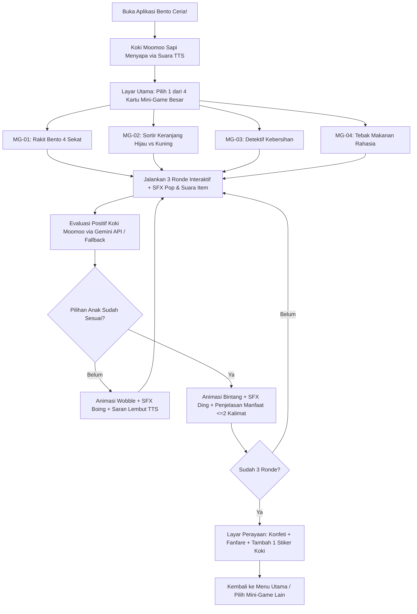

# Product Requirements Document — Bento Ceria! (Game Edukasi Makanan Sehat Anak TK)

**Document Version:** 1.0  
**Application Version:** MVP (v0.1)  
**Status:** Ready for Implementation  
**Last Updated:** 20 November 2026  

---

## 1. Document Information

| Attribute | Details |
| :--- | :--- |
| **Product Name** | Bento Ceria! (Interactive Healthy Food & Hygiene Game for Kindergarten) |
| **Product Type** | Interactive Child-Friendly Browser Web Game (Single-Page Web App via Google AI Studio) |
| **Primary Platform** | Modern Tablet, Mobile & Desktop Web Browser (Chrome, Safari, Edge) |
| **Target MVP Version** | v0.1 (4 Mini-Games, Koki Moomoo Mascot, Audio-First Indonesian TTS, Web Audio SFX, Sticker Reward Board) |
| **PRD Status** | Ready for Implementation |

---

## 2. Problem Background

* **Core Problem:** Anak usia Taman Kanak-Kanak (4–6 tahun) umumnya belum lancar membaca sehingga tidak dapat menggunakan aplikasi edukasi berbasis teks panjang. Di sisi lain, orang tua dan guru PAUD/TK membutuhkan media interaktif yang menyenangkan untuk mengenalkan pola makan gizi seimbang (*Isi Piringku*), batasan camilan tinggi gula/garam, serta kebiasaan kebersihan makanan tanpa menimbulkan ketakutan terhadap makanan tertentu.
* **Affected Persona:** Anak usia TK/PAUD (4–6 tahun) sebagai pemain utama, serta orang tua, guru TK, dan juri mini hackathon sebagai pendamping/evaluator.
* **Current Manual Workarounds:** Buku cerita bergambar statis, poster gizi di dinding kelas, atau video pasif yang tidak memberikan umpan balik personal atas pilihan anak.
* **Consequences of Inaction:** Anak kesulitan membedakan makanan harian vs camilan sesekali, cenderung menolak sayur/buah, dan kurang memahami kaitan antara kebersihan tangan/makanan dengan kesehatan tubuh.

---

## 3. Product Goals & Success Indicators

| Goal ID | Objective | Success Indicator | Target | Measurement Method |
| :--- | :---- | :---- | :---- | :---- |
| **GL-01** | Aksesibilitas penuh bagi anak yang belum bisa membaca | Seluruh instruksi, nama item, dan umpan balik dibacakan suara pemandu | $100\%$ interaksi utama bersuara | Uji *Web Speech API* (`id-ID`) |
| **GL-02** | Durasi bermain singkat & menjaga fokus anak TK | Waktu penyelesaian 1 mini-game (3 ronde) | $2 \text{ – } 3\text{ menit}$ | *Session timer* in-app |
| **GL-03** | Pengalaman positif tanpa hukuman (*Positive Reinforcement*) | Tidak ada layar "Kalah/Game Over"; tiap sesi memberi stiker hadiah | $100\%$ sesi selesai mendapat stiker | Validasi alur akhir mini-game |
| **GL-04** | Keandalan demo & respons AI terstruktur | Respons JSON Gemini valid atau beralih mulus ke data cadangan lokal | $0\%$ *crash* / layar kosong | Uji skema JSON & *offline fallback* |

---

## 4. Target Users & Roles

* **Pemain / Koki Cilik (Primary User — Usia 4–6 Tahun):** Memilih mini-game lewat kartu bergambar besar, menyusun kotak bekal, menyortir makanan, memilih kebiasaan bersih, dan menebak teka-teki suara dengan dipandu karakter **Koki Moomoo**.
* **Pendamping / Guru / Juri Hackathon (Secondary User):** Membuka aplikasi, mengatur tombol suara (*mute/unmute*) jika diperlukan, dan mengamati perkembangan koleksi stiker anak.
* **Koki Moomoo — AI Mascot & Evaluator (System Role — Gemini API + TTS):** Karakter **Sapi lucu bertopi koki putih besar** yang membacakan misi, merespons susunan bekal anak secara hangat dalam maksimal 2 kalimat sederhana, dan memberikan saran pengganti yang lembut.

---

## 5. Business Logic & Rules

### BL-01: Klasifikasi Makanan & Kebersihan (*Nutritional & Hygiene Rules*)
* **Trigger:** Inisialisasi dataset permainan dan setiap kali anak memilih item makanan atau kartu kebiasaan.
* **Kategori Data:**
  1. **`makanan_super` (Sehat — Boleh Setiap Hari):** Terbagi menjadi 5 sub-kategori: `karbohidrat` (`nasi`, `roti_gandum`, `jagung`, `kentang_rebus`), `protein` (`ayam_panggang`, `telur_rebus`, `ikan_kukus`, `keju_tahu_tempe`), `sayur` (`brokoli`, `wortel`, `tomat`, `bayam`), `buah` (`pisang`, `apel`, `semangka`, `jeruk`), dan `minuman_sehat` (`air_putih`, `susu_segar`, `jus_buah_asli`).
  2. **`camilan_sesekali` (Tinggi Gula/Garam/Lemak):** `donat`, `permen`, `kue_krim`, `es_krim`, `kentang_goreng`, `burger`, `keripik_kemasan`, `soda`, `boba_manis`.
  3. **`kebersihan_makanan` (Pasangan Sehat vs Kotor):** `apel_dicuci` vs `apel_jatuh`, `cuci_tangan_sabun` vs `tangan_kotor`, `bekal_tertutup` vs `jajanan_lalat`, `botol_minum_sendiri` vs `minuman_terbuka`.
* **Constraint Bahasa:** Dilarang menggunakan label negatif seperti *"Makanan Jahat"* atau *"Beracun"*; wajib menggunakan istilah *"Makanan Super"* dan *"Camilan Sesekali Saja"*.

### BL-02: Aturan Penilaian 4 Mini-Game (3 Ronde per Mini-Game)
* **Trigger:** Anak memilih salah satu dari 4 kartu mini-game di layar utama.
* **Processing per Mini-Game:**
  1. **MG-01 — Rakit Bento Sehat:**
     * Anak mengisi 4 sekat kotak bekal (`karbohidrat`, `protein`, `sayur_buah`, `minuman_camilan`) untuk 1 karakter hewan (Riko Kelinci, Kiki Monyet, atau Tobi Kura-kura).
     * **Formula Skor Bento ($S_{bento}$):**
       $$S_{bento} = \text{Jumlah Sekat Terisi } \texttt{makanan\_super} \in \{0, 1, 2, 3, 4\}$$
     * Jika $S_{bento} \ge 3$ dan terdapat minimal 1 `sayur` atau `buah`: Status = **`bento_sempurna`** (3 Bintang + Konfeti).
     * Jika $S_{bento} < 3$ (misalnya $\ge 2$ item adalah `camilan_sesekali`): Status = **`perlu_tukar_lembut`**. Koki Moomoo memberi pujian terlebih dahulu lalu menyarankan 1 pengganti sehat (contoh: menukar donat dengan pisang) tanpa mengunci progres anak.
  2. **MG-02 — Sortir Keranjang Belanja:**
     * Muncul 1 item makanan acak per ronde (total 3 item per sesi). Anak mengetuk tombol **Keranjang Hijau (`makanan_super`)** atau **Keranjang Kuning (`camilan_sesekali`)**.
     * Jika cocok: Koki Moomoo bersorak dan mengucapkan 1 kalimat alasan kesehatan. Jika belum cocok: Kartu bergoyang lembut (*gentle wobble*), berbunyi *boing* lucu, dan Koki Moomoo memberi petunjuk hingga anak mengetuk keranjang yang benar.
  3. **MG-03 — Detektif Kebersihan:**
     * Menampilkan 2 kartu kondisi kebiasaan makan/kebersihan per ronde (total 3 ronde). Anak mengetuk kartu yang bersih dan aman.
     * Jika tepat: Lencana centang hijau muncul + narasi alasan kebersihan. Jika kurang tepat: Kartu kotor memudar lembut dan Koki Moomoo mengajak anak memilih kartu yang bersih.
  4. **MG-04 — Tebak Makanan Rahasia:**
     * Koki Moomoo membacakan teka-teki 3 petunjuk (warna, bentuk/tekstur, manfaat tubuh) dengan 3 pilihan kartu makanan besar.
     * Anak memilih hingga menemukan jawaban tepat, lalu mendapatkan fakta singkat menyenangkan.

### BL-03: Sistem Hadiah Stiker & Koleksi Anak (*Sticker Reward Engine*)
* **Trigger:** Menyelesaikan 3 ronde pada salah satu mini-game.
* **Formula / Processing:**
  $$TotalStickers_{t} = TotalStickers_{t-1} + 1$$
* **Expected Output:** Muncul layar perayaan penuh konfeti bintang, melodi fanfare ceria, dan 1 stiker bergambar baru ditambahkan ke **Papan Stiker Koki Moomoo** (tersimpan di `localStorage` browser agar tidak hilang saat anak mencoba mini-game berikutnya).

### BL-04: Mesin Audio-First (TTS + Web Audio SFX) & Offline Fallback
* **Trigger:** Setiap perpindahan layar, sentuhan kartu makanan, atau respons evaluasi dari Gemini API.
* **Constraints:**
  * Seluruh kalimat Koki Moomoo yang dibacakan TTS dibatasi **maksimal 2 kalimat pendek** (maks. 20 kata) agar mudah dicerna anak usia 4–6 tahun.
  * Jika pemain menyentuh kartu baru saat TTS sebelumnya masih berbicara, sistem otomatis membatalkan antrean suara lama (`speechSynthesis.cancel()`) sebelum membacakan suara baru agar tidak bertumpuk.
  * Seluruh efek suara (*pop*, *ding-dong*, *boing*, *fanfare*) dihasilkan via **Web Audio API** dan mematuhi state `is_muted`.
* **Exception Handling:** Jika Gemini API gagal, *timeout* ($> 8\text{ detik}$), atau API key kosong saat demo, sistem otomatis menggunakan evaluator dan bank teka-teki lokal (*Offline Demo Fallback*).

---

## 6. Feature Requirements

| Feature Code | Feature Name | Requirement Description | Related Business Logic | Priority | Target Version |
| :--- | :---- | :---- | :---- | :---- | :---- |
| **FT-01** | Koki Moomoo Animated Mascot | Ilustrasi SVG/CSS **Sapi lucu bertopi koki putih besar** dengan 3 ekspresi dinamis (`senang`, `berpikir`, `bersorak`) dan animasi mulut/kepala bergerak saat berbicara. | BL-02, BL-04 | Must Have | v0.1 |
| **FT-02** | 4-Card Visual Mini-Game Hub | Layar utama berisi 4 tombol kartu ekstra besar bergambar jelas (*Rakit Bento*, *Sortir Keranjang*, *Detektif Kebersihan*, *Tebak Makanan*) dengan pembaca suara otomatis saat disentuh. | BL-02, BL-04 | Must Have | v0.1 |
| **FT-03** | Interactive 4-Slot Bento Builder | Antarmuka kotak bekal 4 sekat tempat anak mengetuk/memilih makanan dari rak visual untuk menyusun bekal karakter hewan. | BL-01, BL-02 | Must Have | v0.1 |
| **FT-04** | 2-Basket Healthy Sorter | Antarmuka penyortiran cepat dengan tombol raksasa **Keranjang Hijau (Makanan Super)** dan **Keranjang Kuning (Sesekali Saja)**. | BL-01, BL-02 | Must Have | v0.1 |
| **FT-05** | Clean Hygiene Pair Inspector | Antarmuka perbandingan 2 kartu kondisi makanan/tangan bersih vs kotor dengan ilustrasi ikon besar dan umpan balik suara instan. | BL-01, BL-02 | Must Have | v0.1 |
| **FT-06** | Voice Riddle Mystery Cards | Antarmuka tebak makanan berbasis petunjuk suara Koki Moomoo dengan 3 kartu gambar besar. | BL-01, BL-02 | Must Have | v0.1 |
| **FT-07** | Indonesian TTS & Web Audio SFX Engine | Pembaca suara otomatis (`id-ID`), tombol raksasa "Dengar Lagi", efek suara *pop/ding/boing/fanfare*, serta tombol *Mute/Unmute*. | BL-04 | Must Have | v0.1 |
| **FT-08** | Koki Sticker Collection Board | Papan koleksi stiker penghargaan di pojok layar yang bertambah setiap menyelesaikan 1 mini-game (3 ronde). | BL-03 | Must Have | v0.1 |
| **FT-09** | Offline Demo Data & Evaluator Fallback | Bank data lokal lengkap untuk keempat mini-game agar aplikasi tetap berjalan lancar meski tanpa koneksi API saat demo. | BL-04 | Should Have | v0.1 |

---

## 7. Main User Flow

---

## 8. Acceptance Criteria

| AC ID | Related Feature | Condition | Expected Behavior | Pass Criteria |
| :---- | :---- | :---- | :---- | :---- |
| **AC-01** | FT-01, FT-02, FT-07 | Aplikasi pertama kali dibuka dan pemain mengetuk layar/kartu | Maskot **Koki Moomoo (Sapi bertopi koki)** tampil dengan ekspresi ceria dan membacakan instruksi dalam Bahasa Indonesia. | Suara TTS terdengar jelas tanpa tumpang tindih dan tombol kartu mudah diklik. |
| **AC-02** | FT-03, FT-01 | Anak mengisi 4 sekat bento dengan 4 donat/permen lalu menekan "Sajikan Bekal" | Koki Moomoo menampilkan ekspresi `berpikir`, memuji usaha anak, dan menyarankan menukar 1 makanan manis dengan buah/sayur. | Tidak muncul kata "Kalah/Salah"; kalimat saran maksimal 2 kalimat sederhana. |
| **AC-03** | FT-04, FT-05, FT-06 | Anak memilih jawaban kurang tepat pada Sortir Keranjang / Kebersihan / Tebak Makanan | Kartu bergoyang lembut, SFX *boing* berbunyi, dan Koki Moomoo memberi petunjuk ramah hingga anak memilih kartu yang tepat. | Anak dapat mencoba ulang langsung tanpa keluar dari ronde aktif. |
| **AC-04** | FT-08, FT-07 | Anak menyelesaikan ronde ke-3 dari salah satu mini-game | Layar perayaan muncul dengan konfeti, melodi fanfare, dan jumlah stiker di Papan Stiker bertambah `+1`. | Stiker baru tersimpan dan terlihat di layar menu utama. |
| **AC-05** | FT-09, FT-07 | Koneksi API terputus saat demo atau tombol *Mute* ditekan | Sistem memuat evaluator/data lokal tanpa *error*, dan saat *Mute* aktif tidak ada suara yang keluar. | Keempat mini-game tetap dapat dimainkan penuh dalam mode *offline* maupun *mute*. |

---

## 9. Validation Test Scenarios

| Test ID | Related Req | Scenario | Test Input | Expected Result | Test Type |
| :---- | :---- | :---- | :---- | :---- | :---- |
| **TC-01** | FT-02, FT-03, FT-08 | Bermain *Rakit Bento Sehat* 3 ronde dengan menu gizi seimbang | Memilih Nasi, Ayam, Brokoli, dan Susu pada tiap ronde | Koki Moomoo bersorak, memberi 3 bintang, dan menambah 1 stiker di akhir ronde 3 | Happy Path |
| **TC-02** | FT-03, FT-01 | Mengisi kotak bekal hanya dengan makanan tinggi gula | Memilih Donat, Permen, Es Krim, dan Soda | Koki Moomoo memberi saran lembut untuk menukar ke sayur/buah tanpa pesan negatif | Boundary Path |
| **TC-03** | FT-04, FT-07 | Mengetuk beberapa kartu makanan secara cepat berturut-turut | Klik cepat pada Apel -> Brokoli -> Pisang | Suara TTS sebelumnya dibatalkan otomatis sehingga suara tidak bertumpuk | Boundary Path |
| **TC-04** | FT-05, FT-06 | Menekan tombol "Dengar Lagi" pada *Tebak Makanan Rahasia* | Klik tombol speaker besar di samping Koki Moomoo | Teka-teki suara dibacakan ulang dengan jelas | Happy Path |
| **TC-05** | FT-09 | Simulasi API *offline* / API key kosong saat presentasi | Memutus internet atau menjalankan tanpa API key | Seluruh 4 mini-game berjalan mulus menggunakan data evaluasi lokal | Error Handling |

---

## 10. Constraints & Out of Scope

### Business & Child-Safety Constraints
* **Prinsip *No-Reading-Required*:** Seluruh navigasi utama wajib dapat dipahami melalui ikon/emoji raksasa, warna kontras, dan panduan suara otomatis.
* **Psikologi Positif Anak:** Menghindari istilah menakutkan (*racun*, *jahat*, *gagal*, *kalah*) serta menghindari batas waktu hitung mundur yang membuat anak TK panik.

### Technical & Platform Constraints
* **Arsitektur Web Ringan:** *Client-side* single-page web app (React/HTML/CSS/JS) terintegrasi dengan **Gemini API (`gemini-2.5-flash`)**, **Web Speech API (`speechSynthesis`)**, dan **Web Audio API** tanpa ketergantungan aset audio MP3 eksternal.
* **Target Sentuh Ramah Anak:** Seluruh tombol interaktif memiliki ukuran minimum $64\times 64\text{ px}$ dengan jarak antar tombol yang cukup untuk menghindari salah sentuh di layar tablet/ponsel.

### Explicit Out of Scope (MVP v0.1)
* Pembuatan akun anak/orang tua, penyimpanan data ke *cloud database* eksternal, atau papan peringkat kompetitif antar-anak.
* Pemindaian kamera *real-time* (difokuskan ke interaksi sentuh layar dan suara agar aman dan stabil digunakan anak TK di berbagai perangkat).

---

## 11. Data Entities & Storage Requirements

State permainan disimpan di memori aplikasi (`React State`) dan koleksi stiker disimpan di `localStorage`:

1. **`FoodItem` Entity:**
   * `id` (String, contoh: `"brokoli_hijau"`)
   * `name` (String, contoh: `"Brokoli Hijau"`)
   * `emoji` (String, contoh: `"🥦"`)
   * `category` (Enum: `"karbohidrat" | "protein" | "sayur" | "buah" | "minuman_sehat" | "camilan_sesekali"`)
   * `health_status` (Enum: `"makanan_super" | "camilan_sesekali"`)
   * `color` (String, contoh: `"hijau"`)
   * `kid_benefit` (String, 1 kalimat singkat bahasa anak TK)
2. **`HygienePair` Entity:**
   * `id` (String)
   * `scenario_voice` (String, kalimat situasi yang dibacakan Koki Moomoo)
   * `healthy_option` (Object: `{ emoji: string, label: string, reason: string }`)
   * `unhealthy_option` (Object: `{ emoji: string, label: string, gentle_hint: string }`)
3. **`PlayerProgress` Entity (`localStorage`):**
   * `stickers_earned` (Array of Strings, ID stiker yang sudah dikumpulkan)
   * `is_muted` (Boolean)
4. **`BentoEvaluationResponse` Entity (Struktur JSON Gemini API):**
   * `status` (Enum: `"bento_sempurna" | "perlu_tukar_lembut"`)
   * `mascot_expression` (Enum: `"senang" | "berpikir" | "bersorak"`)
   * `moomoo_voice_text` (String, maksimal 2 kalimat ramah anak TK)
   * `suggested_swap_id` (String | null, ID makanan sehat yang disarankan jika `perlu_tukar_lembut`)

---

## 12. Assumptions, Risks & Open Items

* **Assumptions:**
  * `[Proposed Assumption]` Perangkat pengguna (laptop/tablet/HP) mendukung *Web Speech API* suara Bahasa Indonesia (`id-ID`); jika suara `id-ID` tidak terpasang di OS tertentu, sistem tetap menampilkan gelembung teks besar dengan ikon ekspresif dan efek suara Web Audio API.
  * `[Proposed Assumption]` Setiap mini-game dibatasi 3 ronde per sesi agar durasi bermain ideal (2–3 menit) untuk rentang perhatian anak usia 4–6 tahun.
* **Risks & Mitigations:**
  * **Risiko Kebijakan *Autoplay Audio* Browser:** Browser modern memblokir suara otomatis sebelum ada sentuhan pertama pengguna. *Mitigasi:* Menampilkan tombol besar **"Ayo Mulai Bermain!"** di layar pembuka yang sekaligus mengaktifkan *AudioContext* dan *SpeechSynthesis*.
  * **Risiko Latensi API saat Anak Menekan Tombol:** Anak TK cenderung tidak sabar jika menunggu lebih dari 3 detik. *Mitigasi:* Menggunakan model cepat `gemini-2.5-flash` dengan animasi Koki Moomoo sedang mengaduk panci saat memuat, serta *timeout* otomatis ke evaluator lokal jika $> 5\text{ detik}$.

---

## 13. Requirement Traceability Matrix

| Business Logic (BL) | Feature Code (FT) | Acceptance Criteria (AC) | Test Case (TC) |
| :---- | :---- | :---- | :---- |
| **BL-01** (Klasifikasi Makanan & Kebersihan) | FT-03, FT-04, FT-05, FT-06 | AC-02, AC-03 | TC-01, TC-02 |
| **BL-02** (Aturan 4 Mini-Game x 3 Ronde) | FT-01, FT-02, FT-03, FT-04, FT-05, FT-06 | AC-01, AC-02, AC-03 | TC-01, TC-02, TC-04 |
| **BL-03** (Sistem Hadiah & Koleksi Stiker) | FT-08 | AC-04 | TC-01 |
| **BL-04** (Audio-First TTS, SFX & Offline Fallback) | FT-01, FT-07, FT-09 | AC-01, AC-04, AC-05 | TC-03, TC-04, TC-05 |